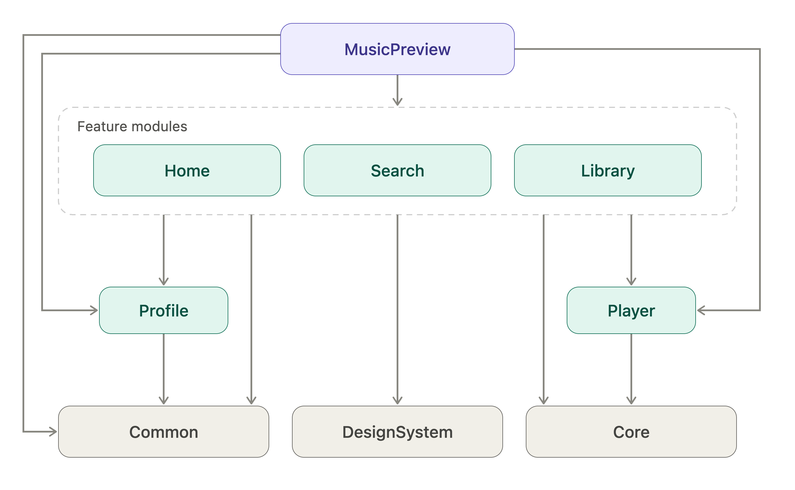

# MusicPreview

An iOS music preview app built with **SwiftUI** and **Combine**, powered by the **iTunes Search API**. Browse the most played tracks, search for songs, listen to 30-second previews, and save your favorites to a local library.

This repository is the **modularized** version of the project: the codebase is split into independent Swift Packages (feature modules + shared modules) to enforce clear boundaries, speed up builds, and make each part testable in isolation.

---

## Table of Contents

- [Features](#features)
- [Modularization](#modularization)
- [Architecture](#architecture)
- [API](#api)
- [Third-Party Libraries](#third-party-libraries)
- [Project Structure](#project-structure)
- [Getting Started](#getting-started)
- [Conventions](#conventions)

---

## Features

| Feature | Description |
|---|---|
| **Home** | Chart of the most played tracks |
| **Search** | Search tracks from the iTunes catalog (debounced, cancels stale requests) |
| **Library** | Saved tracks, persisted locally and observed reactively |
| **Profile** | User profile and preferences, stored in `UserDefaults` |
| **Player** | Full-screen now-playing view and a persistent mini player |

---

## Modularization



The app target (`MusicPreview`) is a thin shell: it wires dependencies together and composes the feature modules. Everything else lives in local Swift Packages under `Modules/`.

| Layer | Modules | Responsibility |
|---|---|---|
| **App** | `MusicPreview` | Entry point, dependency injection, composition of feature modules |
| **Feature modules** | `Home`, `Search`, `Library`, `Profile`, `Player` | Screen UI, view models, and feature-specific logic |
| **Shared modules** | `Core`, `Common`, `DesignSystem` | Domain & data layer, networking utilities, reusable UI components and tokens |

**Dependency rules**

- Dependencies only point **downward**: App → Features → Shared modules.
- Shared modules never depend on feature modules.
- Feature modules should not depend on each other directly; cross-feature needs (e.g. playing a track) are exposed through `Core` abstractions.
- `Common` holds networking utilities (`NetworkService`, request helpers); `Core` holds domain models, use cases, and repositories; `DesignSystem` holds shared UI.

---

## Architecture

The project follows **MVVM** combined with **Clean Architecture** principles, using a **Repository pattern** for data access.

```
┌──────────────────────────────────────────────┐
│ Presentation   SwiftUI Views  ⇄  ViewModels  │
├──────────────────────────────────────────────┤
│ Domain         UseCases · Models · Requests  │
│                Repository protocols          │
├──────────────────────────────────────────────┤
│ Data           Repository impl               │
│                Remote (Alamofire) · Local    │
└──────────────────────────────────────────────┘
```

- **View** – SwiftUI views, kept free of business logic.
- **ViewModel** – `ObservableObject` classes exposing `@Published` state; they talk to use cases only.
- **UseCase** – a single unit of business logic (e.g. search tracks, save a track).
- **Repository** – `Repository imp` abstracts the data sources so the domain layer doesn't know where data comes from.
- **Data sources** – *Remote* (iTunes API via Alamofire) and *Local* (Realm / `UserDefaults`). Async work is wrapped in Combine publishers (`Deferred { Future }`).

### Reactive data flow

- Search input is debounced and uses `switchToLatest` so only the most recent request's result is delivered.
- The Library observes Realm changes reactively instead of doing one-shot reads, so saved tracks update automatically across screens.

### Dependency Injection

A single `@MainActor` `Injection` class creates and owns the shared dependencies **once**:

- `Realm`
- `NetworkService` (an instance with an injected Alamofire `Session`, not a static/global)
- `AudioPlayerManager`

It exposes lazily created per-feature injections (Home, Search, Library, Profile), and `MyApp.init` builds the view models from it using `StateObject(wrappedValue:)`.

---

## API

The app uses the public **[iTunes Search API](https://developer.apple.com/library/archive/documentation/AudioVideo/Conceptual/iTuneSearchAPI/index.html)** — no API key required.

| Purpose | Endpoint |
|---|---|
| Search tracks | `GET https://itunes.apple.com/search?term={query}&media=music&entity=song` |

Track metadata (title, artist, artwork, and the `previewUrl` for the 30-second audio preview) is decoded into `Codable` models.

---

## Third-Party Libraries

| Library | Used for |
|---|---|
| [Alamofire](https://github.com/Alamofire/Alamofire) | Networking (inside `Common`) |
| [Realm Swift](https://github.com/realm/realm-swift) | Local persistence for the saved-tracks library |

Apple frameworks: **SwiftUI**, **Combine**, **AVFoundation** (audio preview playback), **Foundation** (`UserDefaults`).

---

## Project Structure

```
musicpreview-modularization/
├── README.md
├── musicpreview_package_dependencies_v2.png
├── MusicPreview/            # App target (entry point, DI, composition)
└── Modules/                 # Local Swift Packages
    ├── Home/
    ├── Search/
    ├── Library/
    ├── Profile/
    ├── Player/
    ├── Core/                # Domain (Model, Repositories, Request, UseCase) + Data + DI
    ├── Common/              # Networking utilities (NetworkService, URLRequestUtils)
    └── DesignSystem/        # Reusable UI components & styling
```